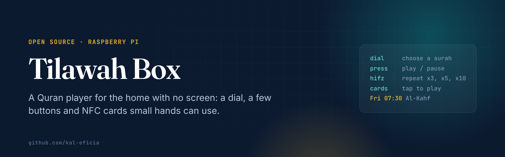
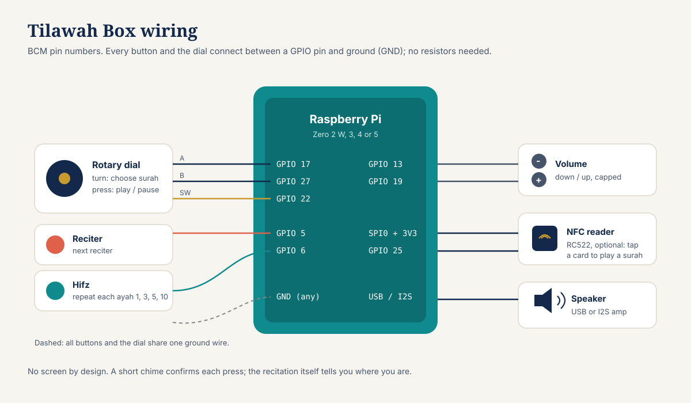

<p align="center"></p>

<p align="center">
  
  
  
  
</p>

Quran apps are everywhere, and every one of them lives on a screen. For children especially, that screen leads straight to everything else.

**Tilawah Box** is a Quran player for the home with no screen at all: a dial, a few buttons and, if you like, NFC cards a three-year-old can use. Turn the dial to choose a surah. Tap the Ya-Sin card to play Ya-Sin. It reads Al-Kahf on Friday mornings and Al-Mulk before bed, on its own.

It's open source, so you build it, you own it, and nobody can put an advert or an autoplay feed in front of your children.

## What it does

- **Dial:** turn to move through the 114 surahs, press to play or pause
- **Reciters:** a button cycles between your chosen reciters (Alafasy, Al-Husary, Al-Minshawi and more)
- **Hifz button:** repeat each ayah 1, 3, 5 or 10 times, for memorisation. Pick a range (Ayat al-Kursi on its own, say) with a card
- **Cards:** tap an NFC card to play its surah or range. Draw on them, laminate them, give them to the kids
- **Routines:** Al-Kahf every Friday, Al-Mulk every night, stop at bedtime
- **Quiet hours:** a lower volume cap at night, and a parent-set maximum all day
- **Offline:** downloads the surahs you use to the SD card, so it keeps working without the internet
- **Bismillah** before every surah except At-Tawbah, and never twice before Al-Fatihah
- **Halal sound:** recitation only. The confirmation chime is a single soft tone, not a jingle

<p align="center"></p>

## Parts (about £60 to £90)

| Part | Notes | Approx. |
|---|---|---|
| Raspberry Pi Zero 2 W (or any Pi 3/4/5) | Zero 2 W is plenty | £15 |
| 32 GB microSD card | holds the whole Quran in two recitations | £7 |
| Speaker | USB speaker, or a MAX98357A I2S amp with a 3 W speaker for a cleaner build | £8 to £15 |
| Rotary encoder with push switch (KY-040) | the dial | £3 |
| 5 × 12 mm push buttons | reciter, hifz, volume down, volume up, spare | £4 |
| RC522 NFC reader + NTAG/MIFARE cards | optional, for the cards | £6 + £5 |
| 5 V 2.5 A power supply, jumper wires | | £10 |
| A wooden or 3D-printed box | big, round, friendly buttons | |

## Build it

1. Flash **Raspberry Pi OS Lite** and connect it to Wi-Fi.
2. Wire the dial and buttons as in the diagram: each one between its GPIO pin and ground.
3. On the Pi:
   ```bash
   git clone https://github.com/kal-eficia/tilawah-box && cd tilawah-box
   cp config.example.json config.json   # set reciters, routines, quiet hours, cards
   ./deploy/install.sh                  # installs mpv, downloads surahs, starts on boot
   ```
4. To add a card, tap it once: its number appears in the log (`journalctl -u tilawah -f`). Put that number in `config.json` with the surah you want.

## Try it without a Pi

```bash
pip install git+https://github.com/kal-eficia/tilawah-box
tilawah sim             # keyboard: ← → choose surah, space play/pause, r reciter, h hifz, + - volume
tilawah sim --silent    # no audio, just shows what would play
tilawah play yasin --reciter husary
tilawah play baqarah --from 255 --to 255 --repeat 5
tilawah check           # confirm each reciter's audio source is reachable
```

## Configure

```json
"routines": [
  { "days": "fri",   "time": "07:30", "surah": "kahf" },
  { "days": "daily", "time": "19:45", "surah": "mulk", "reciter": "minshawi" },
  { "days": "daily", "time": "20:30", "action": "stop" }
],
"quiet_hours": { "from": "20:30", "to": "06:30", "volume": 25 },
"cards": { "584190214313": { "surah": "yasin" } }
```

Surahs can be given by number or name (`"18"`, `"kahf"`, `"Al-Mulk"`, `"yasin"`).

## Audio

Recitation is streamed per ayah from [EveryAyah](https://everyayah.com) and cached on the SD card, which is what makes single-ayah repetition and ranges possible. `tilawah sync` downloads ahead of time. Please respect EveryAyah's service: sync what you need, once.

## Tests

```bash
python -m unittest discover -s tests
```

The tests cover the surah data (114 surahs, 6,236 ayat), Bismillah rules, ranges, memorisation repeats, the dial wrapping round, volume caps, Friday routines, quiet hours across midnight and card lookups.

---

Built by [Kalid Nur](https://github.com/kal-eficia) for his own home. MIT licence.
